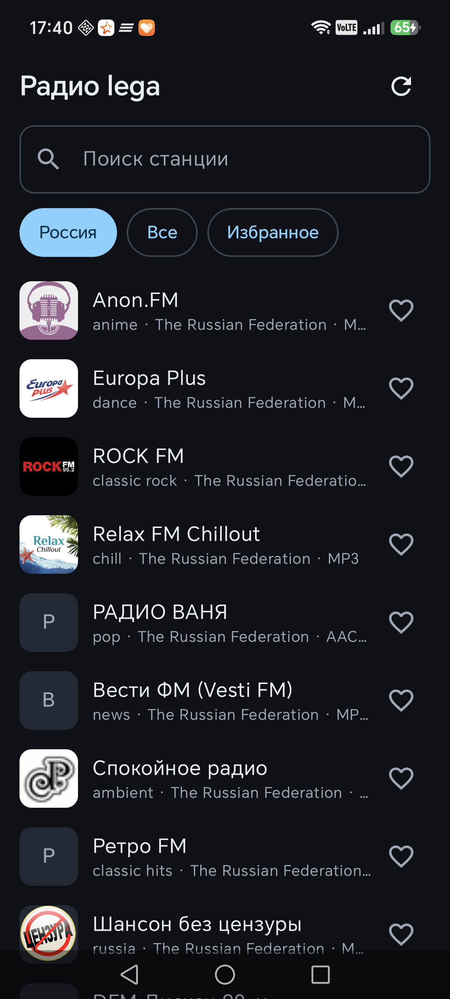
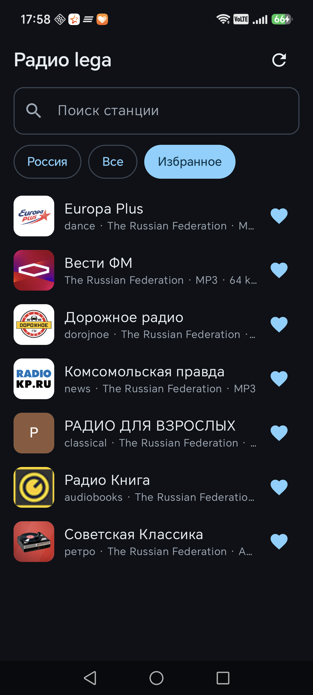
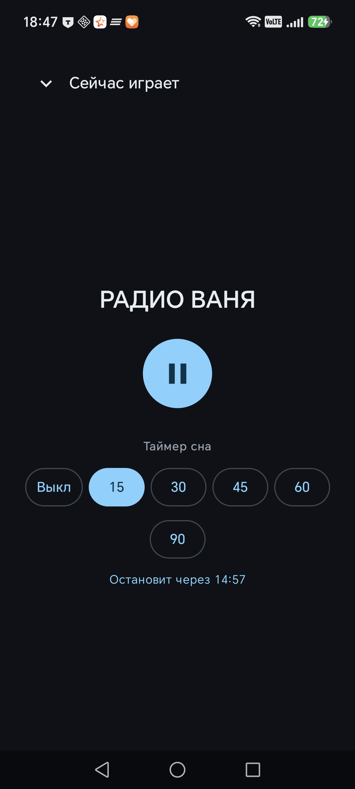
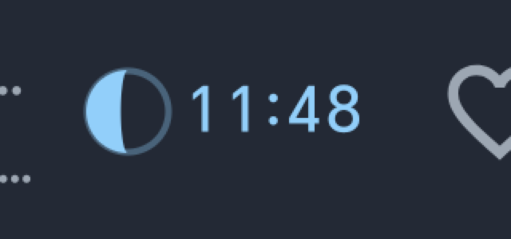

# Радио lega

[](https://github.com/legavaz/radio_lega/actions/workflows/build.yml)

Свой радиоплеер для Android: Kotlin + Jetpack Compose + Media3, каталог из
открытого [Radio Browser](https://www.radio-browser.info/) — без ключей,
без своего сервера, без рекламы и аналитики.

`ru.lega.radio` · minSdk 26 (Android 8) · targetSdk 35 · версия 0.1

| Release APK | Debug APK |
|---|---|
| **3,0 МБ** | 20 МБ |

## Скриншоты

| Список станций | Избранное | Таймер сна |
|---|---|---|
|  |  |  |

Индикатор таймера в мини-плеере крупно — луна показывает текущую фазу:



## Возможности

**Каталог**
- Четыре вкладки: **Россия** (по умолчанию) / **Все** / **Избранное** / **Мои** — ровно одна активна
- **Свои станции по URL**: кнопка «+», проверка адреса, удаление долгим нажатием
- Поиск по названию, жанру и стране — внутри активной вкладки
- Постраничная загрузка (сервер рвёт большие ответы, см. ниже)
- Кэш каталога на диск отдельно для каждого источника — без сети показывается последний список
- Логотипы: `favicon` → иконка по домену сайта (DuckDuckGo) → по домену потока → цветная буква

**Воспроизведение**
- Foreground-сервис на `MediaSessionService` — играет при выключенном экране
- Управление из уведомления, с гарнитуры и Bluetooth (`MediaSession`)
- HLS и обычные ICY/MP3/AAC потоки (выбор по MIME-типу)
- Автоматическое переключение на резервный поток при ошибке
- Пауза при отключении наушников
- Индикация проблемы с потоком в мини-плеере

**Удобство**
- Избранное — из списка и из мини-плеера
- Приложение открывается на **последней станции**: играла — продолжит, стояла на паузе — покажет в паузе
- Таймер сна 15/30/45/60/90 минут + индикатор обратного отсчёта в мини-плеере
- **Затухание звука в последнюю минуту** — линейно до нуля, затем пауза
- **Встряхнуть телефон — продлить таймер** на тот же период: громкость
  возвращается мгновенно, звучат маракасы (отключается переключателем)
- Датчик встряхивания включается **только в последнюю минуту**, и тогда же
  обратный отсчёт становится **жёлтым** — видно, что можно трясти
- Баннер с просьбой исключить приложение из экономии батареи (иначе система глушит фон)

## Чего пока нет

- **ICY-«сейчас играет» (исполнитель — трек)** — реализация была и откачена:
  обёртка над `DataSource` рассинхронизировала поток, звук «заикался».
  Нужен парсер без влияния на аудио. Подробности — `docs/ARCHITECTURE.md`.
- Жанровые подборки
- Виджет (Glance)
- Затухание громкости в конце таймера сна
- Выбор битрейта/потока в полном плеере

## Свои станции

Кнопка **+** в шапке открывает диалог: название и адрес потока
(`http://`, `https://`, поддерживается `.m3u8` для HLS). Станция попадает
во вкладку **«Мои»**, удаляется долгим нажатием с подтверждением.

## Непрерывная сборка

`.github/workflows/build.yml` на каждый пуш в `main`:
JDK 21 → Android SDK 35 → `gradlew test` → `assembleDebug` →
APK в артефактах (`radio-lega-debug`).

## Сборка

Нужен JDK 17–21. На этой машине — `E:\project\tools\jdk21`
(путь зафиксирован в `gradle.properties` → `org.gradle.java.home`).

```powershell
$env:JAVA_HOME="E:\project\tools\jdk21"
cd E:\project\android\myradio

.\gradlew.bat assembleDebug     # app\build\outputs\apk\debug\app-debug.apk
.\gradlew.bat assembleRelease   # app\build\outputs\apk\release\app-release.apk
```

Установка одной командой (сборка + установка + запуск):

```powershell
powershell -ExecutionPolicy Bypass -File install.ps1
```

## Подпись release-сборки

Ключ и пароли лежат в `keystore.properties` (в git не попадает, см. `.gitignore`):

```properties
storeFile=keystore/lega-radio.jks
storePassword=...
keyAlias=lega
keyPassword=...
```

Создать новый ключ:

```powershell
keytool -genkeypair -v -keystore keystore\lega-radio.jks -alias lega `
  -keyalg RSA -keysize 2048 -validity 10000
```

> ⚠️ `keystore/` и `keystore.properties` — **обязательно сохраните отдельно**.
> Потеря ключа = невозможность обновить приложение поверх установленного.

Если `keystore.properties` нет, `assembleRelease` соберётся без подписи и не упадёт.

## Структура

```
app/src/main/java/ru/lega/radio/
├── MainActivity.kt            точка входа, Compose
├── RadioApp.kt
├── domain/Models.kt           Station, Stream
├── data/
│   ├── RadioBrowserApi.kt     клиент каталога: пагинация, зеркала, IPv4, HTTP/1.1
│   └── StationStore.kt        кэш каталога, избранное, последняя станция
├── player/
│   ├── RadioService.kt        MediaSessionService, ExoPlayer, фолбэк, команды
│   ├── PlaybackRegistry.kt    реестр станций + сборка MediaItem
│   └── SleepTimer.kt          таймер сна + его состояние
└── ui/
    ├── Theme.kt               светлая/тёмная схема
    ├── RadioViewModel.kt      состояние экрана, MediaController
    ├── AppRoot.kt             список, мини-плеер, полный плеер, таймер
    ├── BatteryOptimization.kt запрос исключения из экономии заряда
    └── MoonPhase.kt           расчёт фазы Луны (используется в индикаторе)
```

Архитектурные решения и причины — `docs/ARCHITECTURE.md`.
История изменений — `docs/CHANGELOG.md`.

## Особенности Radio Browser API (найдено на практике)

Три вещи ломают «наивный» клиент, в коде они уже учтены:

1. **Ответы длиннее ~18 КБ обрываются.** Сервер (`tiny-http`) отдаёт поток
   chunked и перестаёт слать данные на середине JSON — воспроизводится и с
   телефона, и с ПК. Поэтому каталог грузится **страницами по 12** (`limit`/`offset`),
   и каждая страница сразу отдаётся в UI.
2. **IPv6 не работает у оператора/роутера, а AAAA-записи есть.** OkHttp шёл
   в IPv6 и висел до таймаута. Решение — `Ipv4Dns` (фильтр IPv4 в DNS).
3. **HTTP/2 зависает в этой сети.** Заголовки приходят, тело не читается.
   Принудительно включён HTTP/1.1.

Дополнительно: зеркала `nl1`, `at1`, `fr1` больше не существуют в DNS —
используются только `all` и `de1`. Заголовок `User-Agent` обязателен.

## Известные проблемы

- **Honor/Huawei/Xiaomi** агрессивно морозят фоновые приложения. Лечится
  баннером «Разрешить работу без ограничений» (уже реализован).
- Луна в индикаторе таймера нарисована на Canvas и визуально проверена не до
  конца — при желании легко заменить на статичную иконку.
- Каталог грузится 6–10 секунд: сервер отдаёт страницы с обрывами, часть
  страниц приходится повторять.

## Дисклеймер

Каталог и логотипы принадлежат их правообладателям и загружаются из открытого
Radio Browser. Приложение не хранит и не распространяет аудиоконтент —
только воспроизводит публичные потоки станций.
